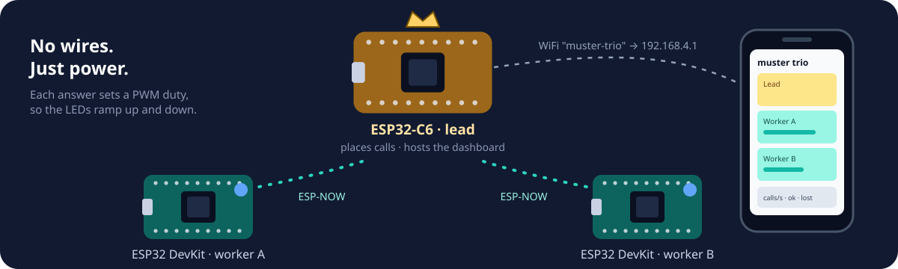
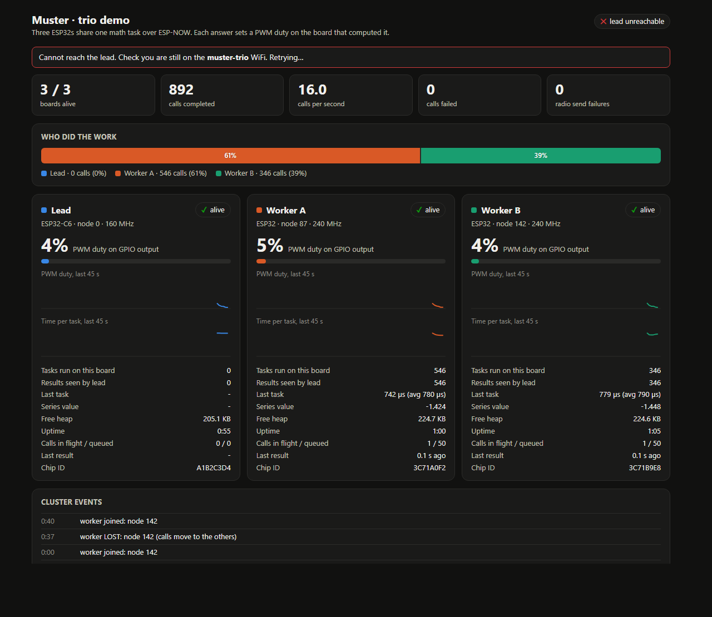
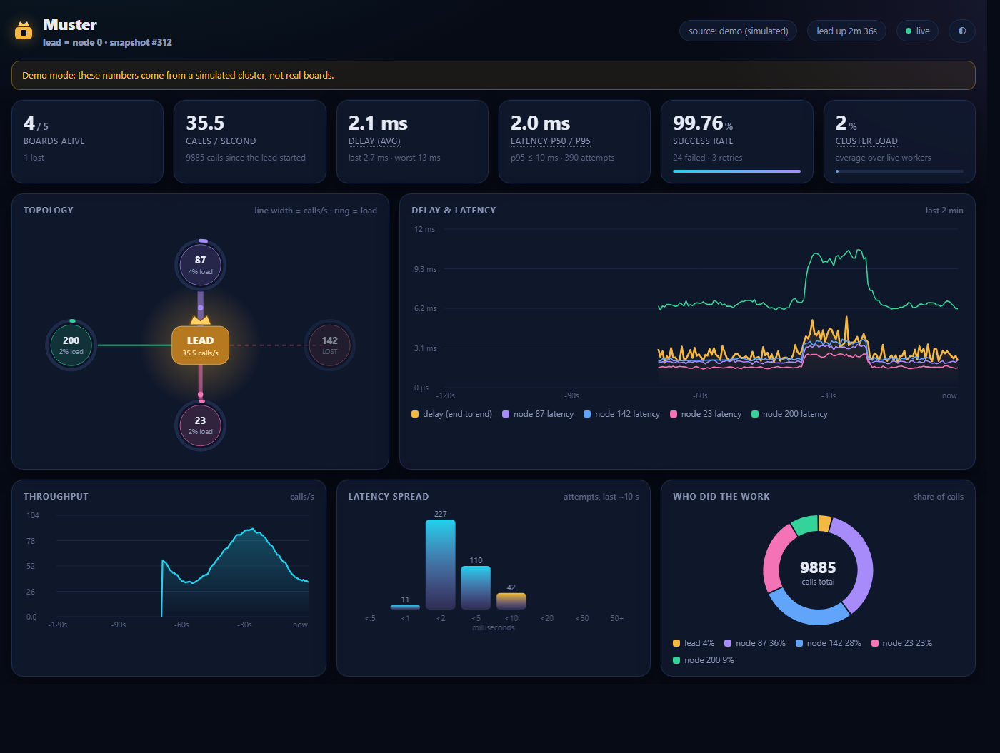
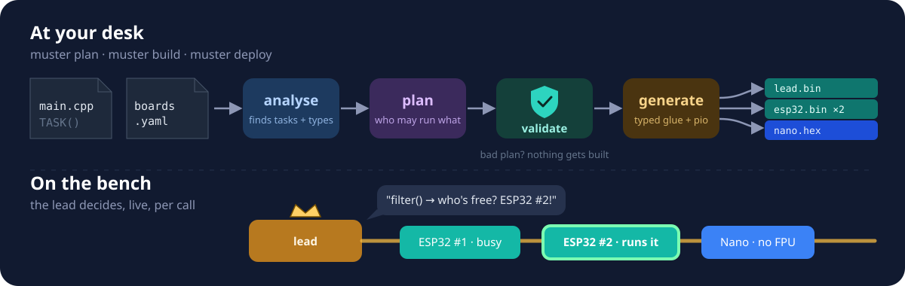
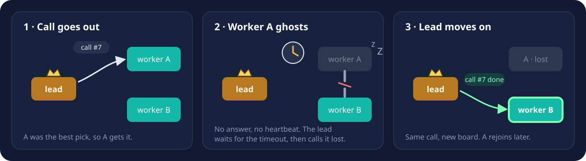
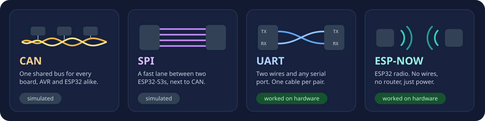

<p align="center">
  
</p>

<p align="center">
  <a href="LICENSE"></a>
  
  
  
  <a href="docs/BOARDS.md"></a>
</p>

<p align="center">
  <a href="#what-muster-is">What it is</a> ·
  <a href="#where-to-start">Where to start</a> ·
  <a href="#try-it-on-real-boards">Real boards</a> ·
  <a href="#the-dashboard">Dashboard</a> ·
  <a href="#how-it-works">How it works</a> ·
  <a href="#which-boards-work">Boards</a> ·
  <a href="#faq">FAQ</a> ·
  <a href="#status">Status</a>
</p>

## What Muster is

Most of us have a drawer of microcontroller boards. An ESP32 with a fast floating-point
unit, an Arduino Nano that's good at reading sensors and bad at maths, another ESP32
that was added later. Getting them to work together usually means writing your own
message formats, deciding by hand which board runs which function, and rewriting a good
part of the firmware the day you move one of them.

We wanted to stop doing that, so we wrote Muster.

The idea is simple. One board is the **lead** and the others are **workers**. You write
ordinary Arduino-style C++ and mark the functions you want to share. Muster works out which
boards are able to run each function and builds firmware for every board. Then, while
everything is running, the lead decides for each call which board should do it, usually
the one that will finish soonest. If a worker stops answering (unplugged, crashed, stuck
in a long loop), the lead notices within about a second and gives the work to another
board. When the worker comes back, it rejoins.

You don't write any networking code. Boards can talk over CAN, SPI, UART or ESP-NOW, or
several of these at once, and the runtime is small enough to run on an ATmega328P with
2 KB of RAM.

> [!NOTE]
> **Where things stand:** the UART and ESP-NOW links have run on real boards. CAN and
> SPI have only run in simulation so far. Everything passes 215 simulated checks in both
> C99 and C++11, and the runtime compiles for 22 boards from AVR, ESP32, STM32, RP2040,
> nRF52, SAMD, NXP Teensy and Renesas. The [Status](#status) section has the details.

## Where to start

It depends on what you have on your desk:

- **No hardware at all.** Run the [simulation tests](#try-it-without-hardware). It takes
  about two minutes and you can watch boards fail over in your terminal.
- **Three ESP32 boards.** Run the [`trio` demo](#try-it-on-real-boards). There's no
  wiring, and you get a live dashboard on your phone.
- **ESP32s, a Nano and some CAN modules.** Wire a bus using [`docs/HARDWARE.md`](docs/HARDWARE.md)
  and flash the [CAN examples](firmware/examples). Set aside an afternoon.
- **A board from another family** (STM32, RP2040, nRF52, Teensy and so on). Check
  [which boards work](docs/BOARDS.md) and flash the self-test sketch.
- **One program you'd like split across boards.** Follow the [walkthrough](#walkthrough-one-program-four-boards).
- **An AI assistant such as Claude Code.** Connect Muster [over MCP](#using-it-from-an-ai-assistant)
  and let it propose the split.

## Try it without hardware

You need `gcc` (or `clang`) and `make`.

```bash
git clone https://github.com/Shaik0Ayman/MUSTER.git
cd MUSTER

make -C firmware/test          # 215 checks: failover, lost frames, all four links
make -C firmware/test cpp      # the same tests built as C++11, the way Arduino builds them
```

The tests start simulated boards, unplug some of them, and check that the work moves
and that the boards rejoin afterwards. Part of the output looks like this:

```text
[   201] lead: node1 (id 133) joined
[   201] lead: node2 (id 132) joined
[  2002] square(3) = 9   ran on node1 (id 133)
[  3500] node2 cable PULLED
[  4402] lead: node2 (id 132) LOST
[  4402] lead: module blink -> node1 (id 133)
[ 10401] lead: node1 (id 133) joined
```

On Windows, run `make` and `gcc` inside WSL. For the Python toolchain, run Python on
Windows and set `MUSTER_HOST_CXX=wsl`.

If you'd rather watch it than read logs, [`firmware/examples/sim_cluster`](firmware/examples/sim_cluster)
runs a lead and two workers inside one simulated ESP32-S3 in [Wokwi](https://wokwi.com),
with an LED per board and buttons that "pull the cable".

## Try it on real boards

This is the setup we've actually run on hardware, and it's the easiest one to build.

<p align="center">
  
</p>

You need an ESP32-C6 for the lead and two ESP32 DevKits for the workers. There are no
CAN modules and no jumper wires; the boards talk over ESP-NOW, the ESP32's own radio.

```bash
cd firmware/examples/trio
pio run -e worker_esp32 -t upload --upload-port COMx   # once for each DevKit
pio run -e lead_c6      -t upload --upload-port COMy   # the C6 (needs PlatformIO Core 6.2.0 or newer)
```

Then connect a phone or laptop to the WiFi network `muster-trio` (password `muster123`)
and open http://192.168.4.1/. The page shows which worker ran each call, how long it
took, and which boards are alive.

<p align="center">
  
  <br><sub>The trio page, shown here with its <a href="firmware/examples/trio/tools/trio_mock.py">preview script</a> and simulated numbers.</sub>
</p>

Now unplug one of the workers. The lead marks it as lost and the other worker takes
all the calls. Plug it back in and it rejoins.

When we ran this on 7 November 2026 (an ESP32-C6 and two DevKits), joining, placement,
failover and rejoining all worked, and each worker took about 900 µs on average to
compute a call. That figure is the computation only. We haven't measured the radio
round trip yet. The full results are in [`docs/TESTING.md`](docs/TESTING.md#hardware-results).

If you don't have a C6, `pio run -e lead_esp32dev` turns a third classic ESP32 into the
lead. The complete guide is in [`firmware/examples/trio`](firmware/examples/trio).

## The dashboard

Once a cluster is running, it's nice to see what it's doing. Muster has an optional
dashboard that shows which board did what, how busy each one is, call latency and
end-to-end delay, how loaded each link is, and failures and retries as they happen.

<p align="center">
  
  <br><sub><code>muster dash --demo</code>, which simulates a five-board cluster so you can try the page without hardware.</sub>
</p>

It's switched off by default, and while it's off it costs nothing. When you switch it
on, the lead keeps a few counters (about 0.5 KB of RAM on an ESP32) and sends a small
binary snapshot over USB a few times a second. Your PC does everything else.

```cpp
#define MUSTER_TELEMETRY 1          // in the lead's build only
// then, four times a second in loop():
uint16_t n = muster_telemetry_frame(&M, frame, sizeof frame);
Serial.write(frame, n);
```

```bash
muster dash --serial COM5 --open    # the page runs on your PC, not on the boards
muster dash --demo                  # or try it now with simulated data
```

If there's no PC nearby, an ESP32 lead can serve the same page itself over WiFi using
`muster_dashboard.h`. That costs about 74 KB of flash. [`docs/TELEMETRY.md`](docs/TELEMETRY.md)
explains what every number means, and [`firmware/examples/dashboard`](firmware/examples/dashboard)
has a lead that's ready to flash.

The dashboard is tested on the host, including decoding frames produced by the real C
code, and the example compiles for ESP32. It hasn't been run against real boards yet.

## How it works

<p align="center">
  
</p>

A few ideas hold the whole thing together:

- **The code lives on the boards, and the choice is made at run time.** An 8-bit AVR
  can't load new code while it runs, so every board is flashed with all the tasks it is
  allowed to run. For each call, the lead picks one of the boards that has that task.
- **Everything goes through the lead.** This hub-and-spoke layout is what keeps
  failover and load balancing simple.
- **Lost messages are retried, and repeats are ignored.** If a call is sent to the same
  board twice, the board answers the second one from a small cache instead of running
  the task again.
- **There's no `malloc`, no threads and no recursion.** Everything is allocated
  statically. A minimal worker on an ATmega328P uses 8.9 KB of flash and 492 B of RAM.

Here's what happens when a board goes quiet:

<p align="center">
  
</p>

Boards can be connected in four ways:

<p align="center">
  
</p>

You can mix them. A board can have up to eight links, and Muster sends each message
over the fastest one that's working. If the SPI cable comes out, traffic falls back to
CAN. [`docs/LINKS.md`](docs/LINKS.md) covers setup, limits and frame sizes for each link.

## Installing the runtime

The runtime is the [`firmware/`](firmware) folder. It's header files only, and it has the
manifests both Arduino and PlatformIO expect. It isn't in the Arduino Library Manager or
the PlatformIO Registry yet, so for now install it from this repository:

- **Arduino IDE:** copy `firmware/` into your sketchbook as `libraries/Muster` (for
  example `Documents/Arduino/libraries/Muster`) and restart the IDE.
- **PlatformIO:** add `lib_deps = symlink://path/to/MUSTER/firmware` to your `platformio.ini`.

In exactly one source file, put `#define MUSTER_IMPLEMENTATION` before
`#include "muster.h"`, then include the link you want to use (see
[Using the runtime directly](#using-the-runtime-directly)).

## Walkthrough: one program, four boards

As an example, let's split a robot-dog program across three ESP32-S3s and a Nano. The
complete project is in [`tools/muster-cli/examples/quadruped_modules`](tools/muster-cli/examples/quadruped_modules).

First, install the toolchain. It needs Python 3.9 or newer and [PlatformIO](https://platformio.org/).

```bash
pip install -e "tools/muster-cli[test]"
```

Then describe the boards you have in `boards.yaml`:

```yaml
shared_images: true            # all the ESP32s run one firmware image
boards:
  - { id: esp32_a, type: esp32-s3-devkitc-1, port: /dev/ttyUSB0 }
  - { id: esp32_b, type: esp32-s3-devkitc-1, port: /dev/ttyUSB1 }
  - { id: esp32_c, type: esp32-s3-devkitc-1, port: /dev/ttyUSB2 }
  - { id: nano,    type: nanoatmega328,      port: /dev/ttyUSB3 }
```

There are no pins in this file. Pins only ever come from the
[board database](tools/muster-cli/muster_cli/db/boards.yaml), so nothing (not even an AI
assistant) can make one up.

Next, write one program for all of the boards, `main.cpp`:

```cpp
#include <Arduino.h>
#include "modules/status_led.h"

struct Gait { float hip[4], knee[4]; };

MUSTER_TASK(needs = fpu, cost = 800, ram = 24)     // placed per call, on a board with an FPU
Gait gait_planner(float speed, float turn) { /* ... */ }

MUSTER_TASK(cost = 20, ram = 1)                    // cheap enough for any board, even the Nano
int16_t sensor_read(uint8_t channel) { return (int16_t)analogRead(channel); }

MUSTER_MODULE(needs = fpu, ram = 16, count = 1)    // a long-running job the lead hands to one board
int8_t gait_controller(uint8_t event);

void setup() { Serial.begin(115200); muster_setup(); }
void loop()  { muster_loop(); }

int8_t gait_controller(uint8_t event) {
    if (event == MUSTER_MOD_RUN) {
        Gait g;   // runs on whichever board the lead picks: this one, or one across the bus
        if (muster_gait_planner(0.5f, 0.0f, &g, 300) == MUSTER_OK) { /* use g */ }
    }
    return 0;
}
```

You don't write `muster_gait_planner()` yourself. Muster generates it, with typed
arguments and a typed result.

Finally, plan, build and flash:

```text
$ muster plan boards.yaml main.cpp
[1/4] analysed main.cpp: 2 task(s)
      - gait_planner     needs=fpu cost=800 ram=24KB  8 B in / 32 B out
      - sensor_read      needs=- cost=20 ram=1KB  1 B in / 2 B out
[2/4] plan from the deterministic baseline
[3/4] validation: 0 error(s), 1 warning(s)
[4/4] generated muster_out/platformio.ini (3 envs)

      lead: esp32_a
      esp32_a    holds gait_planner, sensor_read
      esp32_b    holds gait_planner, sensor_read
      esp32_c    holds gait_planner, sensor_read
      nano       holds sensor_read
      one image (esp32_s3_devkitc_1) for esp32_b, esp32_c: node IDs come from the chip

$ muster build                         # compile every board
$ muster deploy boards.yaml --dry-run  # show the upload commands (the lead goes last)
```

That's four boards and three firmware builds. The two follower ESP32s share an image and
take their node ID from the chip's MAC address. The Nano only gets `sensor_read`, since
it has no FPU and only 2 KB of RAM.

At run time, the lead gives `gait_controller` to one of the ESP32s. If you unplug that
board, the lead moves the module to another one.

<details>
<summary><b>Tasks or modules?</b></summary>

|  | Task | Module |
|---|---|---|
| What it is | One call: arguments in, result out | A long-running job: `START`, then `RUN` often, then `STOP` |
| How you declare it | `MUSTER_TASK(needs=, cost=, ram=)` | `MUSTER_MODULE(needs=, ram=, count=)` |
| Signature | any wire-safe types | `int8_t name(uint8_t event)` |
| Where it runs | per call, on the board that will finish soonest | per board, chosen by the lead; moved if the board is lost |
| State | nothing is kept across boards | starts from scratch when it moves |
| Can it call tasks? | no, it runs inside the bus poll | yes, including the blocking `muster_<task>()` stubs |
| Can it refuse? | no | `START` can return `< 0` (for example if hardware is missing) and the lead tries another board |

A task can take and return `uint8_t/16/32`, `int8_t/16/32`, `float`, `bool`, plain structs
of those (nested is fine), and fixed-size arrays of those. `int`, `long`, `double`,
`size_t`, pointers, references, enums, unions and bit-fields are rejected when you plan,
with a message telling you what to use instead. The reason is that `int` is 16 bits on an
AVR and 32 bits on an ESP32, and that kind of mismatch is miserable to track down on a
live bus.

</details>

<details>
<summary><b>All the commands</b></summary>

| Command | What it does |
|---|---|
| `muster boards` | lists the board types Muster knows |
| `muster analyze main.cpp` | shows tasks, modules, wire types and problems (add `--json`) |
| `muster plan boards.yaml main.cpp [--plan plan.json] [--out DIR]` | validates a plan (the baseline by default) and generates the project |
| `muster build [-e ENV ...]` | compiles every board's firmware (`pio run`) |
| `muster deploy boards.yaml [--dry-run]` | uploads to every board, lead last, and stops at the first failure |
| `muster dash --serial PORT` | opens the live dashboard for a running cluster ([details](docs/TELEMETRY.md)) |
| `muster mcp` | offers all of this to an AI assistant over MCP |

There's more in the [toolchain README](tools/muster-cli/README.md).

</details>

## Using it from an AI assistant

`muster mcp` is a [Model Context Protocol](https://modelcontextprotocol.io) server, so an
assistant like Claude Code can read your sketch, suggest how to split it, and build it.

```bash
claude mcp add muster -- muster mcp
```

After that you can just ask, for example: "Split my robot sketch across these four boards
and build it."

The assistant gets eight tools (`list_boards`, `analyze_source`, `baseline_plan`,
`validate_plan`, `generate_project`, `render_wiring`, `build_project` and `deploy`), and a
few rules it can't get around. The validator always has the final say, so a bad plan (an
FPU task on the Nano, say) is rejected and nothing is generated. Pins only come from the
board database, so it can't invent wiring. And `deploy` only prints what it would do
unless it's explicitly called with `confirm=true`.

## Using the runtime directly

If you don't want the toolchain, you can use `muster.h` by hand. It's a single header.

<details>
<summary><b>A complete worker in about 25 lines</b></summary>

```cpp
#define MUSTER_IMPLEMENTATION
#include "muster.h"
#include "muster_link_twai.h"            // CAN on an ESP32 (muster_link_mcp2515.h for a Nano)

enum { TASK_DOUBLE = 1 };

// A task decodes its arguments, computes, and encodes the result.
// (The toolchain normally writes these for you.)
static int16_t double_tr(const uint8_t *args, uint16_t len, uint8_t *ret, uint16_t cap) {
    muster_rbuf r; muster_wbuf w;
    muster_r_init(&r, args, len);
    int16_t x = muster_get_i16(&r);
    if (r.err) return -1;
    muster_w_init(&w, ret, cap);
    muster_put_i16(&w, (int16_t)(2 * x));
    return w.err ? -1 : (int16_t)w.n;
}

static muster_t M;  static muster_link can;
static uint32_t ms(void) { return millis(); }

void setup() {
    muster_twai_begin(&can, /*node id*/ 1, /*tx*/ 5, /*rx*/ 4);
    muster_begin(&M, 1, /*is_lead=*/0, /*cores*/ 2, /*ram_kb*/ 512, /*mhz*/ 240,
                 MUSTER_CAP_FPU, &can, ms);
    muster_register_task(&M, TASK_DOUBLE, double_tr, /*cost*/ 10);
}

void loop() { muster_poll(&M); }         // call it from one place only
```

To call a task wherever the lead decides to run it:

```cpp
uint8_t args[2], out[2]; uint16_t n = 0;
muster_wbuf w; muster_w_init(&w, args, sizeof args); muster_put_i16(&w, 21);
int8_t st = muster_call(&M, TASK_DOUBLE, args, w.n, out, sizeof out, &n, /*timeout ms*/ 500);
// st == MUSTER_OK means `out` holds the answer (42). Otherwise you get
// MUSTER_ENOHOST, MUSTER_ETIMEOUT, MUSTER_ETASK or MUSTER_ERR.
// For a non-blocking call, use muster_call_async(), then muster_result() until it
// stops returning MUSTER_PENDING.
```

The other links attach in the same way: `muster_mcp2515_begin()`,
`muster_spi_master_begin()` and `muster_spi_slave_begin()`, `muster_uart_attach()` and
`muster_espnow_begin()`. To use more than one, add them with `muster_add_link()`.

One rule matters more than the rest: never put raw structs or native `int` or `double`
values on the wire. Always go through `muster_put_*` and `muster_get_*`, which use fixed
widths and little-endian byte order.

</details>

<details>
<summary><b>Configuration</b></summary>

Every limit is a compile-time macro that you can override with a `-D` flag. The AVR
column shows what you get automatically on a 2 KB ATmega328P.

| Macro | Default | AVR | Meaning |
|---|---|---|---|
| `MUSTER_MAX_NODES` | 8 | 4 | Boards the lead keeps track of (at most 8) |
| `MUSTER_MAX_TASKS` | 16 | 16 | Task IDs (at most 32) |
| `MUSTER_MAX_MODULES` | 8 | 0 | Module IDs (at most 8; `0` leaves modules out entirely) |
| `MUSTER_MAX_MSG` | 96 | 40 | Largest reassembled message, in bytes |
| `MUSTER_MAX_PENDING` | 6 | 2 | Calls in flight |
| `MUSTER_RX_SLOTS` | 4 | 2 | Messages being reassembled at once |
| `MUSTER_MAX_LINKS` | 2 | 1 | Links per board (at most 8) |
| `MUSTER_MAX_FRAME` | 64 | 64 | Must be at least every link's MTU |
| `MUSTER_DEDUPE` | 4 | 1 | Finished calls remembered, so a resend isn't run twice |
| `MUSTER_HEARTBEAT_MS` | 200 | 200 | How often boards send a heartbeat |
| `MUSTER_NODE_TIMEOUT_MS` | 1000 | 1000 | After this much silence a board is declared lost |
| `MUSTER_CALL_TIMEOUT_MS` | 400 | 400 | After this the lead retries or moves the call |
| `MUSTER_MAX_RETRIES` | 2 | 2 | Retries per call |
| `MUSTER_LEAD_PENALTY` | 3000 | 3000 | The cost of running a task on the lead, which has its own job to do |
| `MUSTER_TELEMETRY` | 0 | 0 | Set it to 1 in the lead's build to enable the [dashboard](docs/TELEMETRY.md) |

</details>

## Guarantees and limits

Here is what Muster promises, all of it tested on simulated links. A lost frame is
retried. A resend to the same board is answered from that board's cache, so the task only
runs once. A board that goes silent is declared lost, and its calls and modules move to
other boards. Large messages are split into frames and put back together. If an SPI cable
is pulled, traffic falls back to CAN.

There are also some limits. They're all deliberate, and [`docs/DECISIONS.md`](docs/DECISIONS.md)
explains each one.

- **A call that moves to another board can run twice.** If a board goes quiet in the
  middle of a task and the lead gives the call to someone else, both boards may end up
  running it. So keep tasks safe to repeat, or shorter than `MUSTER_CALL_TIMEOUT_MS`.
- **Tasks shouldn't hog the CPU.** A task or module step that takes longer than
  `MUSTER_NODE_TIMEOUT_MS` will get its board declared lost. Tasks run inside
  `muster_poll()` and must not call `muster_call()`.
- **Everything goes through the lead.** A worker calling another worker is relayed.
- **The lead needs to know what every task costs.** The generated code takes care of this.
- **There are size limits:** 8 boards, 32 task IDs, 8 modules, 8 links and 8-bit call IDs.
- **The core has no checksum of its own**, because the links already have one: CAN has a
  hardware CRC, SPI and UART add a CRC-16, and ESP-NOW frames carry the 802.11 checksum.
- **A module loses its state when it moves.** It starts again on the new board.
- **Nothing is authenticated or encrypted.** Anything on your CAN bus, or any ESP-NOW
  radio in range on the same channel, can talk to Muster. Use it on hardware you control,
  and don't use it for anything safety-critical.

## Which boards work

Muster's core is plain C99 with no dynamic memory, so it builds almost anywhere
there's a C compiler. To check that properly rather than guess, there's a small
self-test sketch, [`firmware/examples/portability`](firmware/examples/portability). It runs a
lead and two workers inside a single chip, unplugs one, and prints `MUSTER SELFTEST: PASS`
or `FAIL` over serial. It compiles for 22 boards across AVR, megaAVR, ESP32, ESP8266, STM32
(F1, F4, G4), RP2040, nRF52, SAMD21/51, SAM3X, NXP (Teensy 4.1, 3.6, LC) and Renesas
(Uno R4). **[`docs/BOARDS.md`](docs/BOARDS.md) has the full list**, with memory use and what
has actually run on real boards (so far, only the ESP32 trio).

For the toolchain (`muster plan`) the board database currently has two boards:

| Board | CPU | RAM | CAN via | Can do |
|---|---|---|---|---|
| ESP32-S3 DevKitC-1 (`esp32-s3-devkitc-1`) | 2 × 240 MHz, FPU | 512 KB | on-chip TWAI + SN65HVD230 | tasks, modules, can lead |
| Arduino Nano (`nanoatmega328`) | ATmega328P, 16 MHz | 2 KB | MCP2515 + TJA1050 | tasks (no FPU, no modules) |

Generated projects talk over CAN. For another link, build with `MUSTER_GEN_LINK_EXTERNAL`
and provide `muster_link *muster_gen_external_link(void)` yourself. Every other board in
`docs/BOARDS.md` works with the runtime used directly. If you'd like `muster plan` to
support your board, add a datasheet-backed entry to the database (please don't guess
pinouts) and follow [`docs/HARDWARE.md`](docs/HARDWARE.md) for wiring and bring-up.

## FAQ

<details>
<summary><b>Do I need WiFi or an internet connection?</b></summary>

No. CAN, SPI and UART are wires. ESP-NOW uses the ESP32's radio directly, without a
router or the internet. The `trio` lead runs its own small access point, but only to
serve its web page.

</details>

<details>
<summary><b>What happens if the lead dies?</b></summary>

The workers can't get new calls until the lead is back. When it restarts, every worker
rejoins on its own (this is tested in simulation). There's no automatic election of a
new lead yet.

</details>

<details>
<summary><b>Can an Arduino Nano be the lead?</b></summary>

The validator allows it, but a Nano lead can only keep track of four boards instead of
eight. In practice an ESP32 makes a much better lead, and the toolchain picks the board
with the most RAM by default.

</details>

<details>
<summary><b>Will a task ever run twice?</b></summary>

Not on the same board, since resends are answered from a cache. On two different boards
it can happen, if the first board went quiet partway through a task and the lead moved
the call. So make tasks safe to repeat, or keep them shorter than the call timeout. Pure
maths functions are ideal.

</details>

<details>
<summary><b>Does the dashboard slow the boards down?</b></summary>

Not unless you turn it on. When it's off, the code isn't compiled in at all, and the
Nano worker is byte-for-byte the same size. When it's on, it only runs on the lead: a few
counter updates per message, plus a few hundred bytes over USB a few times a second. The
page itself runs on your PC.

</details>

<details>
<summary><b>Why not use MQTT, micro-ROS or something bigger?</b></summary>

Those are good choices on boards with an operating system or plenty of RAM. Muster is
aimed at the other end of the scale: an 8-bit Nano with 2 KB of RAM working alongside
ESP32s, with no OS, no heap and no broker. The whole runtime is one C99 header.

</details>

<details>
<summary><b>Is it ready for production?</b></summary>

Not yet. It's a student project that's well tested in simulation, and the UART and
ESP-NOW links have run on real boards. CAN and SPI still need to be brought up on
hardware. Please don't use it for anything safety-critical.

</details>

## Status

| Milestone | State |
|---|---|
| M0–M3: runtime, hardening, multi-link core, SPI link (host side) | Done, verified on simulated buses |
| M6: typed trampoline generator (libclang) | Done, the generated project compiles for every board |
| M8: telemetry and dashboard | Done and host-tested; the example compiles; **not run on boards** |
| M9: MCP server | Done, tested in-process and over a real stdio pipe |
| M10: shared images and lead-assigned modules (protocol v3) | Done in simulation and compiles; **not run on boards** |
| UART and ESP-NOW links | Simulated, and **run on hardware** on 2026-11-07 (ESP-NOW `trio` with failover; UART worked). See the [results](docs/TESTING.md#hardware-results) |
| M4: CAN hardware bring-up | Drivers compile; **not yet run on hardware** |
| M5: SPI hardware | Drivers compile; **not yet run on hardware** |
| Portability across MCU families | The self-test compiles for [22 boards](docs/BOARDS.md) (2026-11-07); **not flashed to them yet** |
| M7: local LLM evaluation | Replaced by the MCP server (decision 21) |

In numbers: 215 host checks pass in C99 and C++11, and there are 83 toolchain tests. A
minimal ATmega328P worker takes 8.9 KB of flash and 492 B of static RAM, and the
self-test cluster fits on everything from a 2 KB Uno to a Teensy 4.1. On the ESP-NOW
`trio`, an ESP32 worker averaged about 900 µs of compute per call.

We haven't measured real link latency yet (the round trip on CAN, UART or ESP-NOW), nor
bus load, failover time, the MAC read on the ESP32-S3, or how CAN behaves while two boards
briefly share an ID. The roadmap and acceptance criteria are in [`docs/ROADMAP.md`](docs/ROADMAP.md).

## What's in the repository

```text
firmware/
  src/muster.h              the whole runtime, in one C99 header
  src/muster_link_*.h       links: twai, mcp2515 (CAN) · spi · uart · espnow · loopback (tests)
  src/muster_dashboard.h    optional: an ESP32 lead serves the dashboard itself
  library.properties/.json  Arduino and PlatformIO library manifests
  test/                     host tests and simulated buses (make)
  examples/                 lead_esp32, worker_esp32, worker_nano (CAN/SPI) · sim_cluster (Wokwi)
                            · trio (ESP-NOW) · dashboard · portability: see examples/README.md
tools/muster-cli/
  muster_cli/               analyse · partition · validate · codegen · pio · wiring · mcp · dash
  muster_cli/db/boards.yaml the only source of pins and board facts
  examples/                 quadruped, quadruped_modules
docs/                       protocol, architecture, links, boards, telemetry, hardware, testing, decisions, roadmap
```

| Read | When you want to |
|---|---|
| [`docs/LINKS.md`](docs/LINKS.md) | choose and connect a link: CAN, SPI, UART or ESP-NOW |
| [`docs/BOARDS.md`](docs/BOARDS.md) | find out whether your board works |
| [`docs/TELEMETRY.md`](docs/TELEMETRY.md) | understand the numbers on the dashboard |
| [`docs/HARDWARE.md`](docs/HARDWARE.md) | wire up boards and avoid the usual afternoon-wasting mistakes |
| [`firmware/examples/README.md`](firmware/examples/README.md) | pick an example to start from |
| [`docs/ARCHITECTURE.md`](docs/ARCHITECTURE.md) | understand the layers and the memory model |
| [`docs/PROTOCOL.md`](docs/PROTOCOL.md) | see the wire format (version 3) and every message flow |
| [`docs/MULTILINK_SPEC.md`](docs/MULTILINK_SPEC.md), [`docs/SPI_LINK_SPEC.md`](docs/SPI_LINK_SPEC.md) | run CAN and SPI together |
| [`docs/DECISIONS.md`](docs/DECISIONS.md) | find out why things are the way they are |
| [`docs/TESTING.md`](docs/TESTING.md) | see what's tested, and the hardware results |
| [`docs/ROADMAP.md`](docs/ROADMAP.md) | see what's planned |
| [`CHANGELOG.md`](CHANGELOG.md) | see what has changed |

## Contributing

We'd be glad of help, especially with these:

- **Hardware results.** Bring up CAN (M4) or SPI (M5) on real boards, measure UART or
  ESP-NOW latency, or flash the portability self-test to a board we haven't tried. Please
  open a *Hardware report* issue either way, whether it worked or not.
- **New boards** in the database, backed by a datasheet.
- **Bug reports that come with a failing host test.** Those are the most useful kind.

Please read [`CONTRIBUTING.md`](CONTRIBUTING.md) first. It lists the few hard rules (no
dynamic allocation, fixed-width wire types, the AVR memory budget) and the checks every
change has to pass. We follow a [Code of Conduct](CODE_OF_CONDUCT.md), and security issues
go through [`SECURITY.md`](SECURITY.md).

## License

Muster is free software under the GNU General Public License v3.0 only ([`LICENSE`](LICENSE),
SPDX `GPL-3.0-only`). Copyright © 2026 The Muster contributors.

One thing worth knowing: `muster.h` is copied into every project the toolchain generates,
so firmware you build with Muster is a combined work and has to be distributable under
GPL-3.0. If that doesn't suit your project, open an issue and we can talk about it. (This
is a plain description, not legal advice.)

## Who made this

Muster was written by Shaik Ayman Hameed Baig, Abhinav Senthil and Lahari, in the
Department of Electronics and Communication Engineering at SRMIST. It started as our
project for *21ECC301P: Microprocessor, Microcontroller and Interfacing Techniques* and
grew from there.

If Muster helped your boards get along, a star on GitHub would make our day.
