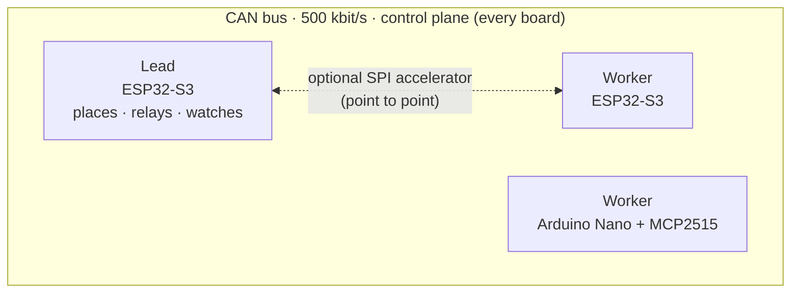
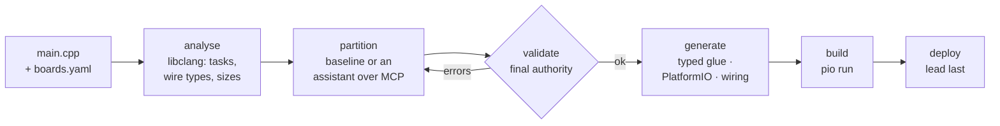

<div align="center">

# Muster

**Write one program. Muster splits it across your microcontroller boards.**

A framework for multi-MCU embedded systems: boards of different families
(8-bit AVR, 32-bit ESP32) share work over CAN and SPI. One **lead** board
decides, live, who runs what. **Workers** join, execute and report.

[](LICENSE)


</div>

> [!WARNING]
> **Status: verified in simulation, not yet on hardware.** The runtime is tested on
> simulated buses (130 host checks, C99 and C++11) and the generated firmware
> compiles for every target. The CAN and SPI drivers compile for their boards but
> **have not been run on real hardware yet**. See [Status](#status) for exactly what
> is and is not proven.

---

## Contents

[Why Muster](#why-muster) · [How it works](#how-it-works) · [Quick start](#quick-start) ·
[Walkthrough](#walkthrough-one-program-four-boards) · [Tasks and modules](#tasks-and-modules) ·
[Command line](#command-line) · [Use it from an AI assistant](#use-it-from-an-ai-assistant-mcp) ·
[Use the runtime directly](#use-the-runtime-directly-c-api) · [Configuration](#configuration) ·
[Guarantees and limits](#guarantees-and-limits) · [Supported boards](#supported-boards) ·
[Status](#status) · [Repository layout](#repository-layout) · [Documentation](#documentation) ·
[Contributing](#contributing) · [License](#license)

---

## Why Muster

A weak 8-bit board that needs a floating-point filter, a fast board that sits idle,
a second fast board you added later: each used to mean hand-written message formats,
a hand-picked "who runs what", and firmware that breaks the day you move a task.

Muster does three things about it:

1. **One program, many boards.** You annotate ordinary Arduino-style C++ functions.
   The toolchain works out which boards can hold which code and builds one
   firmware per board (or per board *type*).
2. **Placement is live.** Every board is flashed with the code it *may* run. At
   run time the lead picks, per call, the board that will finish soonest, and
   re-places the work when a board goes quiet.
3. **The wire format is safe by construction.** Values cross boards as fixed-width,
   little-endian bytes generated for you. An `int` that is 16 bits on an AVR and 32
   on an ESP32 is rejected at plan time instead of corrupting data on the bus.

## How it works



* **Code is resident, placement is live.** An 8-bit AVR cannot load code at run
  time, so each board holds the tasks it may run; the lead chooses among the live
  boards that hold the task.
* **Hub and spoke.** Every call and result passes through the lead, which is what
  makes failover, load-aware placement and (later) a dashboard possible.
* **At-least-once across boards, once per board.** Lost frames are recovered by
  retries; a resent call is answered from a duplicate cache.
* **Static and single-threaded.** No `malloc`, no recursion, no threads in the
  core. It fits a 2 KB ATmega328P.

The toolchain turns one annotated program into per-board firmware:



Whoever proposes a plan (the deterministic baseline, a hand-written file, or an
AI assistant), **the validator decides**, and generation re-validates on its own.

## Quick start

You do not need hardware to try it.

**Requirements:** a C compiler (`gcc`/`clang`) and `make` for the host tests;
Python 3.9+ for the toolchain; [PlatformIO](https://platformio.org/) to compile for
boards; Graphviz (optional) to render the wiring diagram.

```bash
git clone https://github.com/Shaik0Ayman/MUSTER.git
cd MUSTER

# 1. Run the runtime tests (simulated buses: failover, loss, CAN + SPI, modules)
make -C firmware/test            # strict C99
make -C firmware/test cpp        # the same tests as C++11 (Arduino compiles as C++)

# 2. Install the toolchain
pip install -e "tools/muster-cli[test]"

# 3. Split an example program across boards
muster plan tools/muster-cli/examples/quadruped/boards.yaml \
            tools/muster-cli/examples/quadruped/main.cpp
muster build                     # compile it for every board
```

> On Windows, use WSL for `make`/`gcc` and run Python natively, or set
> `MUSTER_HOST_CXX=wsl` so the toolchain tests compile their host round trip
> inside WSL.

## Walkthrough: one program, four boards

Three identical ESP32-S3 boards and a Nano. The full example is
[`tools/muster-cli/examples/quadruped_modules`](tools/muster-cli/examples/quadruped_modules).

**`boards.yaml`** is your inventory. IDs are yours; types must exist in the
[board database](tools/muster-cli/muster_cli/db/boards.yaml), which is also where all
pins come from. Plans never contain pins.

```yaml
shared_images: true            # all ESP32s run ONE firmware image
boards:
  - { id: esp32_a, type: esp32-s3-devkitc-1, port: /dev/ttyUSB0 }
  - { id: esp32_b, type: esp32-s3-devkitc-1, port: /dev/ttyUSB1 }
  - { id: esp32_c, type: esp32-s3-devkitc-1, port: /dev/ttyUSB2 }
  - { id: nano,    type: nanoatmega328,      port: /dev/ttyUSB3 }
```

**`main.cpp`** is one program for every board:

```cpp
#include <Arduino.h>
#include "modules/status_led.h"          // a module kept in its own header

struct Gait { float hip[4], knee[4]; };

MUSTER_TASK(needs = fpu, cost = 800, ram = 24)     // a single call, placed live
Gait gait_planner(float speed, float turn) { /* ... */ }

MUSTER_TASK(cost = 20, ram = 1)
int16_t sensor_read(uint8_t channel) { return (int16_t)analogRead(channel); }

MUSTER_MODULE(needs = fpu, ram = 16, count = 1)    // a long-running job the lead assigns
int8_t gait_controller(uint8_t event);

void setup() { Serial.begin(115200); muster_setup(); }
void loop()  { muster_loop(); }                    // polls the bus, runs this board's modules

int8_t gait_controller(uint8_t event) {            // defined after the generated glue,
    if (event == MUSTER_MOD_RUN) {                 // so it can call tasks anywhere:
        Gait g;
        if (muster_gait_planner(0.5f, 0.0f, &g, 300) == MUSTER_OK) { /* use g */ }
    }
    return 0;
}
```

`muster_gait_planner(...)` is generated: it runs the task on whichever live board the
lead picks, locally or across the bus, and decodes the typed result.

**`muster plan`** analyses, proposes, validates and generates:

```text
$ muster plan boards.yaml main.cpp
[1/4] analysed main.cpp: 2 task(s)
      - gait_planner     needs=fpu cost=800 ram=24KB  8 B in / 32 B out
      - sensor_read      needs=- cost=20 ram=1KB  1 B in / 2 B out
[2/4] plan from the deterministic baseline
[3/4] validation: 0 error(s), 1 warning(s)
[4/4] generated muster_out/platformio.ini (3 envs)

      lead: esp32_a
      esp32_a    holds gait_planner, sensor_read
      esp32_b    holds gait_planner, sensor_read
      esp32_c    holds gait_planner, sensor_read
      nano       holds sensor_read
      module status_led: may run on esp32_a, esp32_b, esp32_c; the lead picks at run time
      module gait_controller: may run on esp32_a, esp32_b, esp32_c; the lead picks at run time
      one image (esp32_s3_devkitc_1) for esp32_b, esp32_c: node IDs come from the chip
```

Four boards, **three** firmware builds:

| Env | Boards | Node ID | Holds |
|---|---|---|---|
| `esp32_a` | `esp32_a` | 0 (the lead) | all tasks + modules, plus the "how many boards" counts |
| `esp32_s3_devkitc_1` | `esp32_b`, `esp32_c` | from the chip's MAC, at run time | all tasks + modules |
| `nano` | `nano` | fixed, 200 | `sensor_read` only (no FPU, 2 KB RAM) |

`muster build` compiles all three. `muster deploy boards.yaml` flashes every board,
lead last, stopping at the first failure so the bus is not left half-flashed. Add
`--dry-run` to print the upload commands without running them.

At run time the lead gives `gait_controller` to one live ESP32. Unplug that board and
the lead re-places the module on another; plug it back and it rejoins.

> **Shared-image caveat.** Boards of one type share an image, so each holds the union
> of the tasks and modules any of them was given. The validator warns when that
> widens a board's set. The lead decides at run time what each board actually does.

## Tasks and modules

|  | **Task** | **Module** |
|---|---|---|
| What | One call: arguments in, result out | A long-running job: `START`, `RUN` (often), `STOP` |
| Declared | `MUSTER_TASK(needs=, cost=, ram=)` | `MUSTER_MODULE(needs=, ram=, count=)` |
| Signature | any wire-safe types | `int8_t name(uint8_t event)` |
| Placed | per call, on the board that finishes soonest | per board, by the lead; moved if the board is lost |
| State | none kept across boards | restarts from scratch when moved |
| May call tasks | no (it runs inside the bus poll) | yes, including the blocking `muster_<task>()` stubs |
| Can decline | no | `START` returns `< 0` (e.g. hardware missing); the lead tries another board |

**What a task may take and return:** `uint8_t/16/32`, `int8_t/16/32`, `float`, `bool`,
plain structs of those (nested), and fixed-size arrays of those. The validator
rejects `int`, `long`, `unsigned`, `double`, `size_t`, pointers, references, enums,
unions and bit-fields, with a message naming the fixed-width replacement. A task
must not touch non-`const` globals (there is no shared memory across boards) and
must be **idempotent or shorter than the call timeout** (see
[Guarantees and limits](#guarantees-and-limits)).

## Command line

| Command | Does |
|---|---|
| `muster boards` | Lists the board types Muster knows |
| `muster analyze main.cpp` | Tasks, modules, wire types and problems (add `--json`) |
| `muster plan boards.yaml main.cpp [--plan plan.json] [--out DIR]` | Validate a plan (default: the baseline) and generate the project |
| `muster build [-e ENV ...]` | Compile every board's firmware (`pio run`) |
| `muster deploy boards.yaml [--dry-run]` | Upload every board, lead last |
| `muster mcp` | Serve the same operations to an MCP client over stdio |

## Use it from an AI assistant (MCP)

`muster mcp` is a stdio [Model Context Protocol](https://modelcontextprotocol.io)
server. The assistant makes the partitioning *judgement*, which is a few facts plus
trade-offs; the toolchain stays deterministic.

| Tool | Purpose |
|---|---|
| `list_boards` | Board types, capabilities, RAM, limits |
| `analyze_source` | Tasks, modules, sizes, problems in a sketch |
| `baseline_plan` | The deterministic plan, as a yardstick |
| `validate_plan` | Check any plan; errors are binding, warnings are advice |
| `generate_project` | Re-validates, then writes the project (never skips validation) |
| `render_wiring` | Wiring diagram from the board database |
| `build_project` | Compile every board |
| `deploy` | Upload every board, lead last. **Dry run unless `confirm=true`** |

Register it with Claude Code (or any MCP client) once the CLI is on your `PATH`:

```bash
claude mcp add muster -- muster mcp
```

The assistant cannot invent pins or skip the validator: pins come only from the
database, and no plan reaches code generation without passing `validate()`.

## Use the runtime directly (C API)

You can use `muster.h` without the toolchain. It is one header; define
`MUSTER_IMPLEMENTATION` in exactly one source file.

```cpp
#define MUSTER_IMPLEMENTATION
#include "muster.h"
#include "muster_link_twai.h"            // CAN on an ESP32; muster_link_mcp2515.h for a Nano

enum { TASK_DOUBLE = 1 };

// A task: decode arguments, compute, encode the result. The toolchain writes these.
static int16_t double_tr(const uint8_t *args, uint16_t len, uint8_t *ret, uint16_t cap) {
    muster_rbuf r; muster_wbuf w;
    muster_r_init(&r, args, len);
    int16_t x = muster_get_i16(&r);
    if (r.err) return -1;
    muster_w_init(&w, ret, cap);
    muster_put_i16(&w, (int16_t)(2 * x));
    return w.err ? -1 : (int16_t)w.n;
}

static muster_t M;  static muster_link can;
static uint32_t ms(void) { return millis(); }

void setup() {
    muster_twai_begin(&can, /*node id*/ 1, /*tx*/ 5, /*rx*/ 4);
    muster_begin(&M, 1, /*is_lead=*/0, /*cores*/ 2, /*ram_kb*/ 512, /*mhz*/ 240,
                 MUSTER_CAP_FPU, &can, ms);
    muster_register_task(&M, TASK_DOUBLE, double_tr, /*cost*/ 10);
}

void loop() { muster_poll(&M); }         // call from ONE context only
```

Calling a task wherever the lead places it:

```cpp
uint8_t args[2], out[2]; uint16_t n = 0;
muster_wbuf w; muster_w_init(&w, args, sizeof args); muster_put_i16(&w, 21);
int8_t st = muster_call(&M, TASK_DOUBLE, args, w.n, out, sizeof out, &n, /*timeout ms*/ 500);
// st == MUSTER_OK -> decode `out`; otherwise MUSTER_ENOHOST / ETIMEOUT / ETASK / ERR
// Non-blocking: muster_call_async() then muster_result() until it stops returning MUSTER_PENDING.
```

Working examples: [`firmware/examples`](firmware/examples) (`lead_esp32`,
`worker_esp32`, `worker_nano`). **Never** send raw structs or native `int`/`double`
on the wire; use `muster_put_*` / `muster_get_*`.

## Configuration

Every limit is a macro, sized at compile time. Override with `-D` flags; the AVR
column shows the automatic defaults for a 2 KB ATmega328P.

| Macro | Default | AVR | Meaning |
|---|---|---|---|
| `MUSTER_MAX_NODES` | 8 | 4 | Boards the lead tracks (max 8) |
| `MUSTER_MAX_TASKS` | 16 | 16 | Task IDs (max 32) |
| `MUSTER_MAX_MODULES` | 8 | 0 | Module IDs (max 8; `0` compiles modules out) |
| `MUSTER_MAX_MSG` | 96 | 40 | Largest reassembled message, bytes |
| `MUSTER_MAX_PENDING` | 6 | 2 | Calls in flight |
| `MUSTER_RX_SLOTS` | 4 | 2 | Concurrent reassemblies |
| `MUSTER_MAX_LINKS` | 2 | 1 | Links per board (max 8) |
| `MUSTER_MAX_FRAME` | 64 | 64 | Must be ≥ every link's MTU |
| `MUSTER_DEDUPE` | 4 | 1 | Finished calls remembered for resends |
| `MUSTER_HEARTBEAT_MS` | 200 | 200 | Heartbeat period |
| `MUSTER_NODE_TIMEOUT_MS` | 1000 | 1000 | A silent peer is declared lost |
| `MUSTER_CALL_TIMEOUT_MS` | 400 | 400 | Then the lead retries or moves the call |
| `MUSTER_MAX_RETRIES` | 2 | 2 | Per call |
| `MUSTER_LEAD_PENALTY` | 3000 | 3000 | Cost of running a task on the lead (it has its own job) |

## Guarantees and limits

**Guaranteed (and tested on simulated buses):** a lost frame is retried; a resend to
the same board is answered from its duplicate cache and runs once; a silent board is
declared lost and its calls and modules are moved; large messages are fragmented and
reassembled per link; a pulled SPI cable falls back to CAN.

**Limits, by design and documented:**

* **At-least-once across boards.** A call moved to *another* board (the first went
  silent, for example stuck in a task longer than `MUSTER_CALL_TIMEOUT_MS`) can run
  twice. Keep tasks idempotent or shorter than the call timeout.
* **A task or module step longer than `MUSTER_NODE_TIMEOUT_MS`** gets its board
  declared lost. Tasks run inside `muster_poll()` and must not call `muster_call()`.
* **Hub and spoke:** worker→worker calls go through the lead.
* **The lead must know every task's cost** (the generated setup does this for you).
* **Max 8 nodes**, 32 task IDs, 8 modules, 8 links; 8-bit call IDs. No checksum in
  the core: CAN has hardware CRC and the SPI link adds CRC-16.
* **Moving a module loses its state.** Placement is not migration.
* **No authentication or encryption on the bus.** Anything on the CAN bus can speak
  Muster. Do not use it where that matters without adding your own protection.
  Muster is not a safety-certified system.

Why each of these is the way it is: [`docs/DECISIONS.md`](docs/DECISIONS.md).

## Supported boards

| Board type | CPU | RAM | CAN | Can run |
|---|---|---|---|---|
| `esp32-s3-devkitc-1` | 2 × Xtensa 240 MHz, FPU | 512 KB | on-chip TWAI + SN65HVD230 | tasks, modules, can lead |
| `nanoatmega328` | ATmega328P 16 MHz | 2 KB | MCP2515 + TJA1050 module | tasks (no FPU, no modules) |

Pins and electrical facts come **only** from
[`db/boards.yaml`](tools/muster-cli/muster_cli/db/boards.yaml). To add a board, add a
datasheet-backed entry there (never guess a pinout), then see
[`docs/HARDWARE.md`](docs/HARDWARE.md) for the wiring and the bring-up order.

## Status

| Milestone | State |
|---|---|
| M0–M3 Runtime, hardening, multi-link core, SPI link (host side) | ✅ verified on simulated buses |
| M6 Typed trampoline generator (libclang) | ✅ generated project compiles for every board |
| M9 MCP server | ✅ tested in-process and over a real pipe; not yet driven from a live client session |
| M10 Shared images + lead-assigned modules (protocol v3) | ✅ simulated + compiles; **not run on boards** |
| M4 CAN hardware bring-up | ⬜ drivers compile; **unverified on hardware** |
| M5 SPI hardware | ⬜ drivers compile; **unverified on hardware** |
| M8 Telemetry and dashboard | ⬜ not built |
| M7 Local LLM evaluation | superseded by MCP (decision 21) |

**Measured:** 130 host checks pass in C99 and C++11 (failover, duplicate suppression,
5 % frame loss, CAN + SPI routing, SPI bit-flip recovery, modules, ID clashes);
74 toolchain tests; a minimal ATmega328P worker is **8.9 KB flash and 492 B static
RAM** (`make -C firmware/test avr`). **Not measured yet:** real bus latency, bus
load, failover time, the MAC read on the ESP32-S3, or the CAN behaviour while two
boards briefly share an ID. Full acceptance criteria: [`docs/ROADMAP.md`](docs/ROADMAP.md).

## Repository layout

```text
firmware/
  src/muster.h              the whole runtime: one C99 header
  src/muster_link_*.h       transports: loopback (tests), twai, mcp2515, spi
  test/                     host tests, simulated buses, `make` targets
  examples/                 PlatformIO projects: lead_esp32, worker_esp32, worker_nano
tools/muster-cli/
  muster_cli/               analyse · partition · validate · codegen · pio · wiring · mcp
  muster_cli/db/boards.yaml the only source of pins and board facts
  examples/                 quadruped, quadruped_modules
  tests/                    toolchain tests
docs/                       protocol, architecture, specs, hardware, decisions, roadmap
```

## Documentation

| Read | When you want to |
|---|---|
| [`docs/ARCHITECTURE.md`](docs/ARCHITECTURE.md) | understand the layers, the contracts and the memory model |
| [`docs/PROTOCOL.md`](docs/PROTOCOL.md) | see the wire format (version 3) and every message flow |
| [`docs/MULTILINK_SPEC.md`](docs/MULTILINK_SPEC.md), [`docs/SPI_LINK_SPEC.md`](docs/SPI_LINK_SPEC.md) | use CAN and SPI together |
| [`docs/HARDWARE.md`](docs/HARDWARE.md) | wire boards and bring up a bus |
| [`docs/DECISIONS.md`](docs/DECISIONS.md) | learn why things are the way they are |
| [`docs/TESTING.md`](docs/TESTING.md) | see what is tested and how |
| [`docs/ROADMAP.md`](docs/ROADMAP.md) | see milestones and their acceptance criteria |
| [`CHANGELOG.md`](CHANGELOG.md) | see what changed |

## Contributing

Contributions are welcome, especially **hardware bring-up results** (M4/M5), new
board entries, and bug reports with a failing host test. Please read
[`CONTRIBUTING.md`](CONTRIBUTING.md) first: it lists the hard rules (no dynamic
allocation, fixed-width wire types, the AVR memory budget) and the checks every
change must pass. For vulnerabilities, see [`SECURITY.md`](SECURITY.md).

## License

Muster is free software under the **GNU General Public License v3.0 only**
([`LICENSE`](LICENSE), SPDX `GPL-3.0-only`). Copyright © 2026 The Muster contributors.

`muster.h` is copied into every project the toolchain generates, so firmware you
build with Muster is a combined work and has to be distributable under GPL-3.0
terms. If that does not fit your use, open an issue to discuss it. This is a
description, not legal advice.

## Authors

Shaik Ayman Hameed Baig, Abhinav Senthil and Lahari, Department of Electronics and Communication
Engineering, SRMIST, built as the project for *21ECC301P: Microprocessor,
Microcontroller and Interfacing Techniques*.
