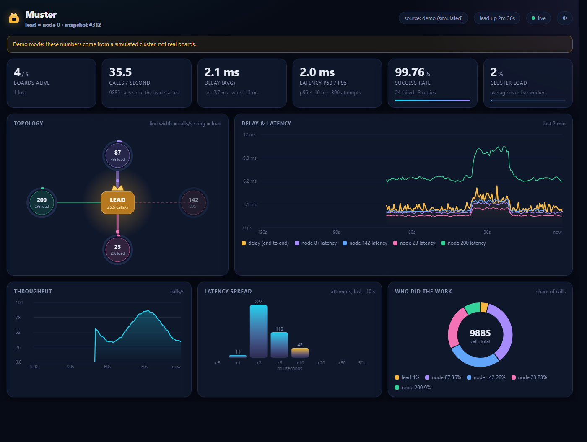

# Telemetry and the dashboard

Because every call and result passes through the lead, the lead can measure the whole
cluster by itself: who did the work, how long it took, how busy each board and link is,
and what went wrong. The workers don't measure anything and don't send anything extra.


<sub>The dashboard with `muster dash --demo` (simulated numbers).</sub>

All of this is optional, and it's off unless you turn it on. Here's what each option costs:

| You want | What to turn on | What it costs |
|---|---|---|
| Nothing | (default) | nothing: telemetry compiles out (`MUSTER_TELEMETRY 0`) |
| The dashboard on your PC | `MUSTER_TELEMETRY 1` in the lead's build, then write `muster_telemetry_frame()` to Serial | lead RAM: ~280 B on AVR, ~0.5 KB on ESP32; a few counter updates per message; ~2 KB/s of serial at 4 snapshots/s |
| The dashboard served by the board itself | the above, plus `muster_dashboard.h` (ESP32 only) | plus ~74 KB flash (WebServer + the page) and ~2 KB RAM |

We measured the cost on the ATmega328P worker build (`make -C firmware/test avr`). With
telemetry off it's 8854 B of flash and 492 B of RAM, exactly the same as before the feature
existed. With it on it's 10484 B and 775 B. That's over the 600 B budget we keep for
workers, which is one more reason to turn it on in the lead's build only. Workers don't
need it anyway, since the lead does all the measuring.

## Quick start

First, add this to the lead's sketch:

```cpp
#define MUSTER_TELEMETRY 1           // before muster.h, in the lead's build only
#define MUSTER_IMPLEMENTATION
#include "muster.h"

// in setup(), after muster_begin():
muster_set_micros(&M, micros);       // optional: microsecond latencies (else millis() * 1000)

// in loop():
static uint32_t last;
if (millis() - last >= 250) {        // 4 snapshots a second
    static uint8_t frame[MUSTER_TEL_FRAME_MAX];
    last = millis();
    uint16_t n = muster_telemetry_frame(&M, frame, sizeof frame);
    if (n) Serial.write(frame, n);   // binary; mixing it with Serial.print text is fine
}
```

Then, on your PC:

```bash
pip install pyserial                          # or: pip install -e "tools/muster-cli[dash]"
muster dash --serial COM5 --open              # /dev/ttyUSB0 on Linux, /dev/cu.* on macOS
```

The dashboard opens at http://localhost:8090/. Anything else your sketch prints still
shows up in your terminal, because `muster dash` only picks the telemetry frames out of the
stream.

If you don't have boards yet, `muster dash --demo` runs the page against a simulated
five-board cluster. If you've captured the serial output to a file, `muster dash --replay
capture.bin` plays it back. And if there's no PC nearby, an ESP32 lead can serve the page
itself (see [On-board hosting](#on-board-hosting-esp32) below).

A complete example with both options is in [`firmware/examples/dashboard`](../firmware/examples/dashboard).
It works with the `trio` workers.

## What the numbers mean

The board only keeps counters, which grow (and eventually wrap). The page subtracts two snapshots
to get rates, so the board never divides or keeps a time window.

| On the page | Where it comes from | Notes |
|---|---|---|
| **Delay** | per call: from `muster_call_async()` (or a worker's CALL reaching the lead) to the final result, **including retries and failover** | what your code feels; average ≈ the last 8 calls |
| **Latency** (per board, p50/p95) | per attempt: from the lead dispatching a call to a board until that board's RESULT arrives | includes both trips over the link plus the task's run time; p50/p95 are estimated from an 8-bucket histogram (≤0.5, 1, 2, 5, 10, 20, 50 ms, more) |
| **Load** (per board, cluster) | sum of attempt latencies per second | the share of time a board had a call in flight, *as seen by the lead*. It includes link time, so it reads a little higher than pure CPU busy time |
| **Calls/s**, **share of calls** | completed + failed attempts | per board and in total |
| **Success rate** | calls that ended `MUSTER_OK` against the rest | failures include `ENOHOST`, `ETIMEOUT` and task errors |
| **Retries** | the lead gave up waiting on a board and re-sent or moved a call | a board that goes quiet shows up here first |
| **Link load** | Muster payload bytes (both directions) ÷ the link's nominal rate | ignores CAN bit stuffing and radio overhead, so the real wire load is higher |
| **Events** | the last `MUSTER_TEL_EVENTS` (8) events, with sequence numbers | if snapshots are too far apart, the page says how many it missed |

Latencies use `muster_set_micros()` if you give it a clock, else `millis() × 1000`
(1 ms resolution: fine for CAN, too coarse for a fast SPI link). Microsecond counters
wrap after about 71 minutes; the page handles the wrap because it only uses differences.

## The frame (version 1)

All fields are fixed-width little-endian (`muster_put_*`), like everything else Muster
sends. Frame = `'M' 'T'` · `version` (u8, = 1) · `payload length` (u16) · payload · `crc16`
(CRC-16/CCITT-FALSE over version, length and payload, same as `muster_crc16`).
Maximum size: `MUSTER_TEL_FRAME_MAX` = 7 + 50 + 24 × links + 49 × nodes + 1 + 9 × events
(570 B with the ESP32 defaults: 2 links, 8 boards, 8 events).

Payload:

| Field | Type | |
|---|---|---|
| seq | u16 | snapshot number |
| t_ms | u32 | lead's `millis()` |
| lead, nlinks, nnodes, flags | u8 × 4 | flags bit 0: a µs clock is set |
| ok, failed, retries | u32 × 3 | calls, end to end |
| delay_last, delay_avg, delay_max | u32 × 3 | µs |
| hist[8] | u16 × 8 | attempt latency buckets |
| *per link* (nlinks ×): kbps, mtu | u16 × 2 | |
| tx_frames, tx_bytes, rx_frames, rx_bytes, tx_fail | u32 × 5 | |
| *per board* (nnodes ×): id, alive, cores, flags, inflight | u8 × 5 | flags = `MUSTER_CAP_*` |
| clock_mhz, ram_kb | u16 × 2 | |
| uid, queued | u32 × 2 | |
| ok, failed, retries, busy_us, lat_last, lat_avg, lat_min, lat_max | u32 × 8 | per attempt, µs |
| nevents | u8 | |
| *per event*: seq | u16 | |
| t_ms | u32 | |
| ev, a, b | u8 × 3 | `MUSTER_EV_*` and its arguments |

Decoders: [`muster_cli/telemetry.py`](../tools/muster-cli/muster_cli/telemetry.py)
(Python), the page's own JavaScript, and the one in
[`firmware/test/test_telemetry.c`](../firmware/test/test_telemetry.c). A toolchain test
decodes a frame produced by the real C code. This frame goes to a PC, not between boards,
so it has its own version (`MUSTER_TEL_VERSION`) and doesn't change `MUSTER_PROTO_VERSION`.

## On-board hosting (ESP32)

```cpp
#define MUSTER_TELEMETRY 1
#define MUSTER_IMPLEMENTATION
#include "muster.h"
#include "muster_dashboard.h"
static muster_dashboard dash;

// setup(), once WiFi is up (softAP or station):
muster_dashboard_begin(&dash, &M, 80);
// loop(), after muster_poll():
muster_dashboard_poll(&dash);
```

The board serves the same page from flash and answers `/api/frame` with a fresh
snapshot, at most every 250 ms however many browsers are watching. The page decodes the
binary frame itself, so the board never formats JSON. `muster_dashboard.h` compiles to
nothing on non-ESP32 boards.

The page lives in `tools/muster-cli/muster_cli/dash/index.html`. The board's copy,
`firmware/src/muster_dashboard_page.h`, is generated from it by `dash/embed.py`, and
`make -C firmware/test` fails if the two differ.

## Status

- Counters, the frame, both decoders and the PC dashboard: host-tested
  (`test_telemetry`, `tools/muster-cli/tests/test_telemetry.py`).
- `firmware/examples/dashboard` (both envs) and `muster_dashboard.h`: **compile for
  ESP32; not yet run on hardware.**
